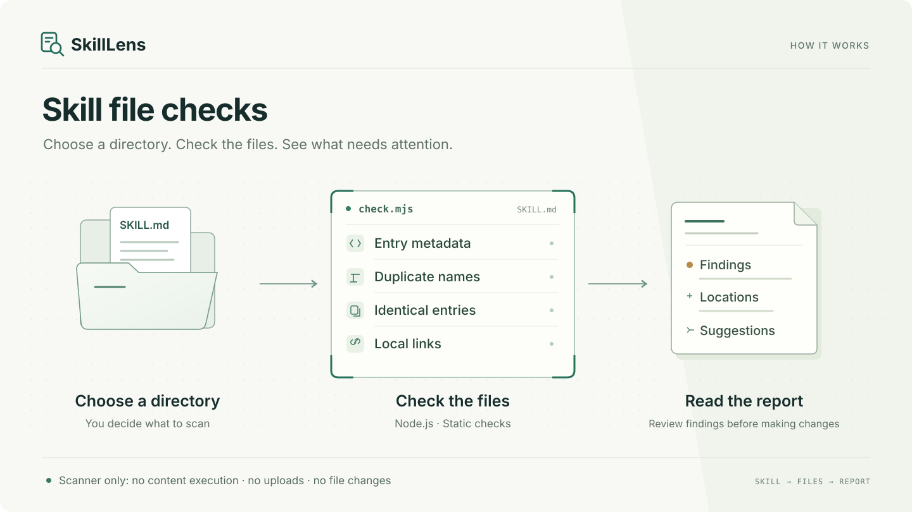

# SkillLens

**A skill that checks your skills — with evidence, not guesses.**

Find entry problems and review potentially conflicting skill instructions. A dependency-free Node.js checker collects static evidence and queues pairs; your agent reads both entries and assesses whether their obligations can coexist under the same conditions.



[中文说明](README.zh-CN.md) · [Detection rules](docs/rules.md) · [Report example (中文)](docs/reporting.md) · [Security boundaries](SECURITY.md) · [Release checklist](docs/releasing.md)

> v0.2.0 early preview adds optional, entry-only conflict review. No host loading-order inference, semantic proofs, automatic repairs, or security certification. Agent assessments are conditional, not observed host failures. The installable identifier is `skill-lens`; registry and trademark availability have not been checked.

## Try it locally

Requires Node.js 22 or newer. No `npm install`, model API, API key, browser, or network request is needed by the checker.

From a local checkout:

```sh
node skills/skill-lens/scripts/check.mjs examples/broken
node skills/skill-lens/scripts/check.mjs examples/healthy --json
npm test
```

The broken demonstration is deliberately broken and exits **1**. Its expected findings are:

```text
[warning] REFERENCE_MISSING alpha/SKILL.md:7
[warning] NAME_COLLISION alpha/SKILL.md
[error]   METADATA_MISSING no-metadata/SKILL.md:1
```

This excerpt groups findings for explanation; the actual report sorts by file and rule. The healthy example has no findings and exits 0. Neither example is a real-world user case or proof of market demand.

Windows PowerShell may block the `npm.ps1` shim; use `npm.cmd test` or run `node --test` directly. This does not require changing execution policy.

## Install the skill

The installable unit is **only** `skills/skill-lens/`. Keep `SKILL.md`, the entire `scripts/` directory (including `check.mjs` and `conflicts.mjs`), and `LICENSE` together. Do not install the intentionally broken examples.

Copy that directory into the skill directory explicitly configured for your agent. Do not assume all agents use the same search paths; consult your host's documentation. This release does not auto-detect or modify agent configuration.

If you use the `skills` installer, run this from the checkout and select your intended agent and scope:

```sh
npx skills add . --skill skill-lens
```

Or install from [the GitHub repository](https://github.com/wuzeno/SkillLens), selecting your intended agent and scope:

```sh
npx skills add wuzeno/SkillLens --skill skill-lens
```

To inspect discovery without installing, append `--list`. The installer is a separate third-party tool and may use the network or change your agent's skill directory. It is not required to run the checker. Remote discovery does not establish that every host can load or invoke the installed skill.

Then ask your agent:

> Use skill-lens to inspect only `/the/directory/I/authorize`. Explain errors, warnings, and unknowns. Do not change anything.

The agent runs the bundled checker, not a script found inside the target. Skill invocation and discovery depend on the host; a live host installation test is part of the release checklist, not yet a claim of universal compatibility.

## Direct usage

```sh
node skills/skill-lens/scripts/check.mjs "/explicit/skill-directory"
node skills/skill-lens/scripts/check.mjs "/explicit/skill-directory" --json
node skills/skill-lens/scripts/check.mjs --help
```

One explicit directory per scan. The root may contain a single entry or multiple nested entries. The tool reads discovered files named exactly `SKILL.md`; it does not guess whether other directories were meant to be skills. It writes no scan results to disk and never executes scanned content.

| Exit | Meaning |
| --- | --- |
| 0 | No error findings. Warnings/info may exist, including no skills found. |
| 1 | At least one error, with operational coverage complete within the documented scope. |
| 2 | Usage/root failure, incomplete static scan or conflict packet, or invalid imported review. |

JSON contains `schemaVersion`, canonical `root`, `profile`, `coverage`, `counts`, `skills`, and `findings`. Fatal failures instead contain `schemaVersion` and `failure`. Findings include `rule`, `severity`, relative `file`, optional `line`, `evidence`, and `suggestion`. Entry hashes cover the entire LF-normalized file, not its support files. No timestamps or random IDs are added, so an unchanged environment yields stable output.

## Optional conflict review (v0.2.0)

```sh
node skills/skill-lens/scripts/check.mjs examples/conflicts/approval --conflicts --json
```

This opts into schemaVersion 2; default static output stays schemaVersion 1. The checker produces limited opposing-directive/description-overlap candidates, full bounded source snapshots and every included pair, including pairs with no candidates. Your agent must then read BOTH entries for EVERY pair, assess task/target/stage, satisfiable conditions and exceptions, and distinguish contradictory obligations from compatible rules or routing overlap. No agent review means semantic review is still pending, even with exit 0.

For example, editing after approval and forbidding edits before approval can coexist. Requiring the same final answer exclusively in French and exclusively in German cannot, if both rules jointly apply. This language example is intentionally outside the rule extractor's vocabulary: the agent must not limit review to keyword hits.

An optional `--review <review.json>` re-scans and validates an agent-authored review's snapshot, complete pair coverage and exact citations from BOTH entries. It does not certify the reasoning: accepted results remain `provenance: agent_assessment` and `semanticTruthVerified: false`. Saving a review requires separate permission to write the artifact; scan consent alone is read-only. `needs_context` remains unresolved even when every pair has been assessed.

The checker makes no model calls and does not upload sources; the current agent session remains subject to its provider's privacy terms. Linked content and real host activation/precedence are not reviewed. The bounded packet has explicit truncation limits; incomplete packets return exit 2. Neither candidate counts nor semantic judgments alter static error counts. See [the full conflict contract and paired examples (中文)](docs/conflicts.md).

A user-run WorkBuddy test exercised the four synthetic pairs; the saved reviews were independently accepted by the installed checker, and all eight test entries retained their byte hashes. This is bounded host evidence, not universal compatibility or a proof of actual simultaneous activation. See [the dated verification record](docs/verification.md#2026-10-31-workbuddy-user-run-conflict-review).

## What makes this different from a prompt?

- **Evidence first:** deterministic checks cite locations and report what was actually observed.
- **Local by default:** no telemetry, uploads, runtime dependencies, or model calls in the checker. Your agent provider's own privacy policy still applies when an agent reads or explains results.
- **Conservative interpretation:** a name collision is not a proven override; a missing destination may be optional; unfamiliar YAML is unverified, not automatically invalid.
- **Human-approved changes:** the skill proposes fixes and asks first. The scanner has no repair mode.

## Honest limits

The built-in frontmatter reader supports a documented subset, not full YAML. Link checks cover only inline Markdown destinations beginning `./` or `../`; they do not recursively inspect supporting documents. Symbolic links/junctions are skipped; roots with symlink components are rejected. Explicit exclusions and size limits are listed in [the rule reference](docs/rules.md).

`coverage.complete` means no operational interruption **within the static rules**; `conflicts.coverage.complete` separately covers the bounded review packet, not completion or truth of semantic review. Check `semanticReview`, pending and unresolved counts. Neither field establishes host compatibility. Unknown metadata and skipped links still have to be reviewed. This is not a sandbox for actively changing, hostile filesystems.

## Development

```sh
node --test
node skills/skill-lens/scripts/check.mjs skills
```

Tests use temporary directories and include failure cases, normal cases, scope boundaries, symbolic links, limits, JSON and exit codes. CI covers Node.js 22/24 on Linux, Windows and macOS. The first published source revision passed all six jobs; see the [dated verification record](docs/verification.md#2026-10-30-github-publication-evidence) and [current CI runs](https://github.com/wuzeno/SkillLens/actions). Completed CI does not prove live-agent compatibility.

See [CONTRIBUTING.md](CONTRIBUTING.md) before adding rules. Stronger host adapters, declared dependency checks and baselines remain future work. Optional entry-only agent semantic review is available in v0.2.0; it is an assessment workflow, not a semantic proof engine.

## License

MIT. Original implementation; no Hallmark code, theme assets, or documentation copied. Hallmark inspired the packaging idea of a focused skill with executable support, not these detection rules.
