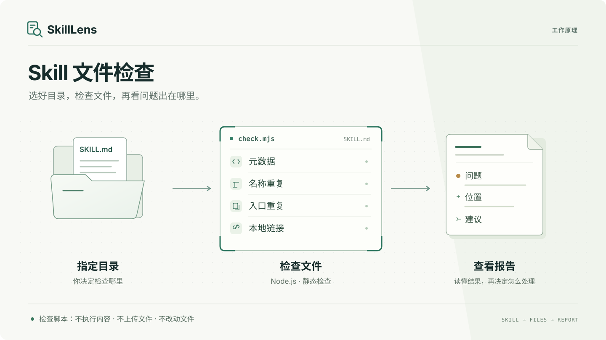

# SkillLens

检查 Skill 的入口问题，以及同一任务下可能互相矛盾的指令。

自带的 Node.js 脚本检查元数据、重名、相同入口和失效本地引用。开启冲突模式后，它整理双方原文与配对队列；Skill 再逐对阅读，区分条件矛盾、触发重叠和暂时无法判断的情况。只读检查，不自动修复。



[English](README.md) · [规则与限制](docs/rules.md) · [报告示例](docs/reporting.md) · [安全边界](SECURITY.md) · [发布清单](docs/releasing.md)

> v0.2.0 早期预览版新增指令冲突审查，范围仅限技能入口。语义结论来自 agent 对原文和条件的判断，不是脚本的证明，也不是已经观察到的宿主故障。它不判断加载优先级，不自动修复，检查通过不代表安全认证。
>
> 项目叫 SkillLens，安装时用的名字是 `skill-lens`，仓库在 [wuzeno/SkillLens](https://github.com/wuzeno/SkillLens)。包名和商标是否可用，目前还没有核实。

## 本地试用

需要 Node.js 22+。检查脚本不依赖其他运行时包，不用 npm install，也不需要模型 API 或密钥，可以离线运行。

在项目目录运行：

```sh
node skills/skill-lens/scripts/check.mjs examples/broken
node skills/skill-lens/scripts/check.mjs examples/healthy --json
node --test
```

故障样例应该能查出重名、链接指向的文件不存在、缺少元数据这几类问题，退出码为 1。健康样例应该没有发现问题，退出码为 0。这些样例是为测试准备的，不是真实用户案例。

Windows 如果不允许运行 npm.ps1，可以用 npm.cmd test 或 node --test，不用修改系统执行策略。

## 安装与使用

只需要安装 `skills/skill-lens/`，保留里面的入口文件、脚本和 LICENSE 许可声明。examples 里的故障样例用于测试，不要一起装进去。

手动安装时，把这个目录复制到你配置好的 agent 技能目录。不同 agent 的路径不同，需要你自己确认；SkillLens 不会自动查找或修改配置。也可以使用第三方 skills 安装器，在本地仓库里运行：

```sh
npx skills add . --skill skill-lens
```

从 GitHub 安装则运行下面的命令，按提示选择 agent 和安装范围：

```sh
npx skills add wuzeno/SkillLens --skill skill-lens
```

如果只想看看安装器能否找到这个技能，不想安装，在命令后加上 `--list`。

第三方安装器可能联网或修改技能目录。不想用安装器也没关系，检查脚本可以单独运行。安装器能找到技能，不代表你用的 agent 一定能加载和调用它；静态检查也不能证明所有 agent 都兼容。

安装后，可以对 agent 说：

> 使用 skill-lens，只检查我明确授权的目录。区分错误、风险与未知，不要修改任何文件。

也可以直接运行脚本：

```sh
node skills/skill-lens/scripts/check.mjs "明确授权的目录" --json
```

每次只查你指定的一个目录。脚本会查找 SKILL.md 并读取正文，但不会继续读取它引用的文档，也不会执行被检查文件中的命令、上传内容，或向扫描目录写入、修改文件。

检查脚本在本地运行，不代表整个 AI 会话都离线。通过 agent 使用时，仍需留意该服务的隐私政策。

## 检查指令冲突（v0.2.0）

```sh
node skills/skill-lens/scripts/check.mjs examples/conflicts/approval --conflicts --json
```

规则会提示可疑指令，但不把命中当作确证。冲突模式为每个纳入范围的 Skill 对保留原文和审查位置；即使规则没命中，agent 也要逐对阅读。它需要回答：双方是否用于同一任务、条件是否能同时成立，以及要求是否真的不能同时履行。例如，“获批后修改”和“未获批不修改”可以相容；“同一最终回答只能法语”和“只能德语”则在共同激活时不相容。

没有 agent 逐对审查，单独跑脚本只完成候选整理。开启模式后 JSON 为 schemaVersion 2；不加参数仍是原来的静态报告。保存审查 JSON 需要单独的写入许可，再用 `--review` 检查快照、配对和双方引文。证据校验通过不等于推理已被证明，`needs_context` 仍是未决项。详见[冲突审查流程、格式和四组成对演示](docs/conflicts.md)。

不会自动扫描你的全局技能目录，也不会自行安装到宿主。已由用户在 WorkBuddy 中跑完四组成对演示；保存的审查记录再次通过校验，八份测试入口与测试前哈希一致。这个有限测试不代表所有宿主兼容或已验证两个技能会共同激活，见[验证记录](docs/verification.md#2026-10-31-workbuddy-user-run-conflict-review)。

## 读懂报告

| 退出码 | 含义 |
| --- | --- |
| 0 | 没有 error，仍可能有 warning/info；也可能没有找到技能。 |
| 1 | 有 error，且在已声明规则范围内无操作性中断。 |
| 2 | 参数错误、根目录无法访问、静态扫描或冲突证据包不完整、审查 JSON 校验失败。 |

报告会列出发现了什么、依据是什么、建议怎么处理，并附上规则编号、严重程度和相对路径；能定位到行时，也会给出行号。

JSON 中的 coverage.complete 只表示静态扫描在规定范围内没有中断。冲突模式另看 conflicts.coverage.complete（证据包完整性）、semanticReview（是否审过）和未决数量。两种 complete 都不表示所有语法、宿主行为和安全问题已查过；退出码 0 也不表示语义相容。

有些结果还需要你判断：名字相同，不一定会互相覆盖；入口文件相同，不代表整个技能包相同；失效链接指向的也可能只是可选内容。

元数据解析器只能处理部分 YAML 写法。遇到不支持的语法，会标记为未验证，不会直接认定源文件有错。链接检查只针对以 ./ 或 ../ 开头的内联 Markdown 链接和图片路径。

## 工程范围

目前不处理依赖版本的选择，不自动安装、同步或修复 Skill，也不探测命令依赖。冲突审查给出带条件和引文的判断，不给健康分数或安全等级；没有读取的支持文件、未实际测试的宿主行为都保留为未知。

测试包含正常和故障样例，也检查符号链接、越界引用、扫描限制、报告是否稳定以及退出码是否正确。首次公开的源码已通过 Linux、Windows、macOS 与 Node 22/24 的全部六组 CI，详见[带日期的验证记录](docs/verification.md#2026-10-30-github-publication-evidence)和[当前 CI 运行](https://github.com/wuzeno/SkillLens/actions)。这些测试通过，不代表已经在所有真实 agent 中验证过。

规则、文件大小限制、跳过的目录、贡献要求和发布检查都在对应文档里。项目使用 MIT 许可，没有复制 Hallmark 的代码或素材。
